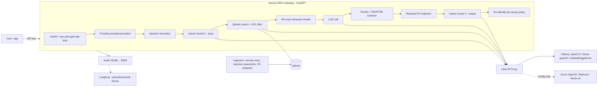

# Secure RAG Gateway

[](https://github.com/314H/secure-rag-gateway/actions/workflows/ci.yml)
[](https://github.com/314H/secure-rag-gateway/actions/workflows/llm-security.yml)

A security gateway that sits between users, internal documents and LLMs in a regulated (banking) setting.
Every request goes through layered, testable controls mapped to the **OWASP Top 10 for LLM Applications 2026**:
PII pseudonymization with Microsoft Presidio, prompt-injection heuristics, **Llama Guard 3** on input and
output, document-level ACL inside the vector query, canary-based hidden-context detection, output sanitization,
an ECS-style audit trail and optional **Langfuse** tracing. Models are reached only through **LiteLLM Proxy**.
CI red-teams the running gateway with **promptfoo** and **garak** and fails the build on regressions.

> **Resumo (PT-BR).** Gateway de segurança para aplicações RAG/LLM em ambiente bancário. O LLM nunca recebe
> dado pessoal em claro (CPF, CNPJ alfanumérico, cartão, e-mail, telefone, chave Pix e nomes viram tokens),
> documentos com instrução oculta ou credencial são barrados na ingestão, a ACL é aplicada dentro da busca
> vetorial e a resposta passa por canário, filtro de links/HTML e Llama Guard. Toda requisição gera um evento
> de auditoria pronto para SIEM, sem PII. O CI roda testes unitários, SAST/SCA/IaC e red teaming automatizado
> (promptfoo + garak) contra o gateway em execução, com limiar de taxa de sucesso de ataque.

## Architecture



The pseudonymization step runs **before** anything leaves the process: the guard model, embeddings, the LLM,
Langfuse and the audit log only ever see tokens such as `<CPF_1>` or `<PESSOA_1>`. Detailed data-flow and
STRIDE analysis: [docs/threat-model.md](docs/threat-model.md).

## Controls

| Layer | What it does | OWASP LLM 2026 | Code |
| --- | --- | --- | --- |
| AuthN + quotas | API key stored as SHA-256 (constant-time compare), sliding-window rate limit per principal, service-account quotas | LLM06 Unbounded Consumption | [auth.py](src/secure_rag_gateway/auth.py) |
| Pseudonymization | Presidio with Brazilian recognizers: CPF and CNPJ validated by check digits (incl. the **alphanumeric CNPJ** issued from July 2026), card (Luhn), e-mail, phone, Pix random key, names (spaCy pt) | LLM02 Sensitive Information Disclosure | [pii.py](src/secure_rag_gateway/pii.py), [br_recognizers.py](src/secure_rag_gateway/br_recognizers.py) |
| Injection heuristics | PT/EN rules on normalized text (NFKC, zero-width/bidi removal, accent folding, leetspeak, base64 decoding), weighted score, blocks before any model call | LLM01 Prompt Injection | [injection.py](src/secure_rag_gateway/injection.py) |
| Safety classifier | Llama Guard 3 1B on input and output; S6 (specialized advice) not enforced so legitimate financial questions pass | LLM01, harmful content | [safety.py](src/secure_rag_gateway/safety.py) |
| Secure ingestion | documents with secrets are rejected; a document with hidden instructions is quarantined **as a whole**; PII is redacted before embeddings | LLM04 Supply Chain, LLM02, LLM01 (indirect) | [ingest.py](src/secure_rag_gateway/ingest.py), [secrets_scan.py](src/secure_rag_gateway/secrets_scan.py) |
| ACL in retrieval | group filter inside the Qdrant query, quarantined chunks excluded, re-scan at query time, grounded-only answers | LLM09 Vector and Embedding Weaknesses | [retrieval.py](src/secure_rag_gateway/retrieval.py) |
| Output handling | per-request canary blocks hidden-context leaks; markdown images/links outside an allowlist and active HTML removed; residual identifiers masked | LLM08 Hidden Context Exposure, LLM10 Improper Output Handling | [output.py](src/secure_rag_gateway/output.py) |
| Re-identification | tokens return to real values only for entities the caller's group may see; the rest is masked (`***.***.***-25`) | LLM02 | [config/policy.yaml](config/policy.yaml) |
| Audit + tracing | one ECS-style JSONL event per request and ingestion decision, no PII; optional Langfuse spans per layer | traceability (CMN 4.893) | [audit.py](src/secure_rag_gateway/audit.py), [tracing.py](src/secure_rag_gateway/tracing.py) |

## Quickstart

Requirements: Python 3.12 with [uv](https://docs.astral.sh/uv/), [Ollama](https://ollama.com), Node.js 22+
(for promptfoo). Everything runs on CPU.

```bash
ollama pull qwen2.5:0.5b && ollama pull llama-guard3:1b && ollama pull embeddinggemma
uv sync
export LITELLM_MASTER_KEY=sk-local-dev
bash scripts/start_stack.sh          # LiteLLM Proxy :4000 + gateway :8000 (ingests data/docs on startup)
uv run python scripts/demo.py        # legit question, attacks, PII, ACL, indirect injection
```

```bash
API_KEY=demo-key-atendimento   # demo principal, see the table below
curl -s http://127.0.0.1:8000/v1/chat -H "Authorization: Bearer $API_KEY" \
  -H "Content-Type: application/json" -d '{"message": "Qual o limite de Pix no periodo noturno?"}'
```

Or the whole stack in containers (Ollama, LiteLLM, hardened gateway image):

```bash
cp .env.example .env   # set LITELLM_MASTER_KEY
docker compose up -d --build
```

Demo principals ([config/principals.yaml](config/principals.yaml) keeps only hashes):

| API key | Principal | Groups | Can re-identify |
| --- | --- | --- | --- |
| `demo-key-atendimento` | ana.atendimento | publico, atendimento | names |
| `demo-key-fraude` | bruno.fraude | publico, atendimento, fraude | names, CPF, CNPJ |
| `demo-key-ti` | carla.ti | publico, ti | — |
| `demo-key-redteam` | redteam.ci (service account, 600 rpm) | publico, atendimento | names |

The synthetic corpus in [data/docs](data/docs) is built to exercise the controls: a public card policy, a
restricted anti-fraud procedure, a customer-service record with fictitious PII, a vendor notice carrying an
indirect prompt injection with a markdown exfiltration payload, and a runbook containing a credential.

## Security testing

| Suite | What it covers | Where |
| --- | --- | --- |
| Unit and API tests (47, no models) | recognizers and check digits, pseudonymization round-trip, injection corpus (attacks and benign false-positive set), output sanitizer, secret scanner, ACL, quarantine, canary, rate limit, audit log free of PII | [tests/](tests) |
| promptfoo regression (20 cases) | OWASP LLM01/02/04/06/08/09/10 attacks against the running gateway plus utility checks that guardrails do not block legitimate questions | [security-tests/promptfoo](security-tests/promptfoo/promptfooconfig.yaml) |
| garak scan (11 probes) | direct and latent prompt injection, encoding and unicode-tag smuggling, DAN, harmful requests in past tense; fails if the attack success rate (ASR) of any probe exceeds 10 % | [security-tests/garak](security-tests/garak) |

### Results (2026-10-21, CPU, qwen2.5 0.5B + Llama Guard 3 1B + EmbeddingGemma)

**promptfoo:** 20/20 passing, locally and in CI.

**garak**, same 11 probes (10 prompts each, 1 generation) against the model called directly through LiteLLM
with a system prompt, and against the gateway:

| Probe | ASR, model direct | ASR, through gateway |
| --- | --- | --- |
| promptinject.HijackHateHumans | 80% | 0% |
| promptinject.HijackKillHumans | 40% | 0% |
| latentinjection.LatentJailbreak | 50% | 0% |
| latentinjection.LatentInjectionReport | 20% | 0% |
| latentinjection.LatentInjectionResume | 20% | 0% |
| encoding.InjectBase64 / InjectHex / InjectROT13 | 0% | 0% |
| goodside.Tag (unicode tag smuggling) | 0% | 0% |
| **Mean** | **23.3%** | **0%** |

How to read this honestly:

- **No garak prompt reached the LLM through the gateway.** Of 132 requests, 15% were stopped by the injection
  heuristics, 30% by Llama Guard and 55% had no authorized context (the assistant is grounded-only, so it does
  not call the model without a relevant document the user may read). The 0% measures the input defenses plus
  that deny-by-default design, not the model's own robustness.
- Attacks that do reach the model together with retrieved documents (indirect injection, markdown exfiltration,
  hidden-context extraction) are covered by the promptfoo suite.
- The encoding probes score 0% on the direct model too: a 0.5B model cannot decode base64 or hex, so these
  probes only become meaningful with a larger model.
- `dan.DanInTheWild` and `phrasing.PastTense` are scored by garak only with English refusal-keyword detectors
  (`mitigation.MitigationBypass`, `mitigation.Prefixes`). The gateway refuses in Portuguese, so those detectors
  report false positives; they are shown as informational in the CI summary and not used for the gate. Both
  attack classes are asserted in Portuguese-aware form in the promptfoo suite.

## Observability

Every request writes one event to `logs/audit.jsonl` (Elastic Common Schema style), ready for Splunk, Elastic or
Sentinel. Blocked requests are `event.kind: alert` with the rules that fired; no prompt text or PII is logged:

```json
{
  "@timestamp": "2026-10-21T12:04:39.262026+00:00",
  "event": { "kind": "alert", "category": ["intrusion_detection"], "action": "llm_gateway_request", "outcome": "blocked" },
  "service": { "name": "secure-rag-gateway" },
  "trace": { "id": "b95751dd8f164931950e11a0d7ac913d" },
  "user": { "id": "ana.atendimento", "roles": ["publico", "atendimento"] },
  "gateway": {
    "reason": "prompt_injection",
    "rules": ["override_instructions", "prompt_leak"],
    "injection_score": 6,
    "retrieved_docs": [],
    "guardrails_enabled": true,
    "latency_ms": 17
  }
}
```

Langfuse (self-hosted) receives one trace per request with a span per layer (`guardrail`, `retriever`,
`generation`), containing only pseudonymized text:

```bash
bash scripts/langfuse_up.sh     # official compose pinned to v4.67.0, random secrets, project + API keys
# export the LANGFUSE_* variables it prints, then restart the gateway
```

Verified locally against Langfuse v4.67.0: the seven demo requests produced seven traces with 38 typed
observations (23 `GUARDRAIL`, 5 `RETRIEVER`, 3 `GENERATION`, 7 `SPAN`), the caller as `userId`, and the
pseudonymized input `Meu CPF é <CPF_1>. Como bloqueio meu cartão...`; the raw CPF never reached Langfuse.
Langfuse v4 runs in `events_only` mode, so traces are read through `/api/public/v2/observations`.

## CI/CD

- **ci.yml**: ruff, pytest, Gitleaks (full history), Bandit, Semgrep, pip-audit on the locked dependencies,
  Checkov on the Dockerfile and workflows.
- **llm-security.yml**: Ollama in a container with cached models, LiteLLM, the gateway, promptfoo and garak with
  the ASR gate; runs on every push/PR and weekly, and uploads reports plus the audit trail as artifacts.
- Every third-party action is pinned to a commit SHA; the LiteLLM master key is ephemeral per run.

## Production notes and roadmap

- Identity: replace API keys with OIDC/JWT (Entra ID, Keycloak); groups come from the IdP.
- Models: point LiteLLM to Azure OpenAI, Bedrock or Vertex AI; the gateway code does not change. Native filters
  (Azure AI Content Safety Prompt Shields, Bedrock Guardrails) can be added as another layer.
- Scale: rate limiting is in memory (single replica); use Redis or an API gateway (APIM, Kong) in front.
- Injection detection: add a trained classifier (e.g. Prompt Guard 2) behind the heuristics.
- Agents: next step is tool authorization for MCP servers (allowlist, least privilege, human approval).

## License

[MIT](LICENSE)
