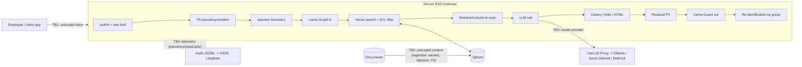

# Threat model — Secure RAG Gateway

Scope: an internal banking assistant that answers employee questions from internal documents through an LLM.
Method: data-flow diagram + STRIDE per element, with each threat mapped to OWASP Top 10 for LLM Applications
2026, MITRE ATLAS and the control/test that covers it.

## Trust boundaries

| Boundary | What crosses it | Assumption |
| --- | --- | --- |
| TB1 user → gateway | prompts | hostile; may contain injection, jailbreak, PII, oversized payloads |
| TB2 documents → index | internal docs, vendor content | may carry hidden instructions, secrets or PII |
| TB3 gateway → model | pseudonymized prompt + authorized chunks | the provider must never receive raw PII; the model is non-deterministic and can be manipulated |
| TB4 gateway → telemetry | events, traces | logs are a data destination too: no PII, no secrets |

## STRIDE

| # | Element | STRIDE | Threat | OWASP LLM 2026 / ATLAS | Control | Test |
| --- | --- | --- | --- | --- | --- | --- |
| T1 | API | Spoofing | call without identity or with a stolen key | — | API key stored as SHA-256, constant-time compare; OIDC in production | `test_requires_valid_api_key` |
| T2 | API | DoS | flooding, huge prompts, token exhaustion | LLM06 Unbounded Consumption | per-principal sliding window, `max_input_chars`, `max_output_tokens`, LiteLLM rpm/tpm | `test_rate_limit`, promptfoo LLM06 |
| T3 | Prompt | Tampering | direct prompt injection, obfuscated (leet, zero-width, base64, chat-template tokens) | LLM01 · AML.T0051.000 | normalization + weighted rules before any model call | `test_injection_detected`, promptfoo LLM01, garak promptinject/encoding |
| T4 | Prompt | Elevation | jailbreak personas (DAN), harmful requests | LLM01 · AML.T0054 | heuristics + Llama Guard 3 on input | garak dan, phrasing; promptfoo Llama Guard |
| T5 | Documents | Tampering | indirect injection hidden in a document | LLM01 · AML.T0051.001 · ASI01 Agent Goal Hijack | ingestion quarantine of the whole document, re-scan at query time, untrusted-content delimiters | `test_quarantined_chunk_never_reaches_llm`, promptfoo, garak latentinjection |
| T6 | Index | Info disclosure | user retrieves chunks above their clearance | LLM09 Vector and Embedding Weaknesses | ACL filter inside the vector query (`MatchAny` on groups) | `test_document_acl_is_enforced`, promptfoo LLM09 |
| T7 | Index | Info disclosure | secrets indexed and leaked by similar questions | LLM02 · LLM04 Supply Chain | secret scanner rejects the document at ingestion | `test_ingestion_rejects_secrets...`, promptfoo |
| T8 | Prompt/answer | Info disclosure | PII sent to the provider, logs or traces | LLM02 Sensitive Information Disclosure | Presidio pseudonymization (CPF, CNPJ incl. alphanumeric, card, e-mail, phone, Pix, names) before TB3/TB4 | `test_llm_never_sees_raw_pii...`, `test_audit_log_has_no_raw_pii` |
| T9 | Answer | Info disclosure | system prompt / hidden context leaked | LLM08 Hidden Context Exposure | per-request canary; block on leak; no secrets in prompts | `test_canary_leak_blocks_response`, promptfoo LLM08 |
| T10 | Answer | Tampering | markdown image / link exfiltration, XSS in the client | LLM10 Improper Output Handling | allowlisted domains only; active HTML stripped | `test_markdown_exfiltration_removed...`, promptfoo LLM10 |
| T11 | Answer | Info disclosure | model emits raw identifiers | LLM02 | residual structured-PII redaction on output | `test_model_generated_raw_identifier...` |
| T12 | Telemetry | Repudiation | no evidence of who asked what and what was blocked | — (CMN 4.893 audit trail) | ECS-style JSONL event per request/ingestion, request id, rules fired | `test_audit_log_has_no_raw_pii` |
| T13 | Config | Elevation | guardrails disabled by mistake | — | `UNSAFE_DISABLE_GUARDRAILS` refused unless `ENVIRONMENT=test` | `test_guardrails_cannot_be_disabled_outside_test` |
| T14 | CI/CD | Tampering | compromised action or dependency | LLM04 Supply Chain | actions pinned by SHA, gitleaks, Bandit, Semgrep, pip-audit, Checkov | `ci.yml` |

## Residual risks (accepted, documented)

- Heuristic injection detection is bypassable by novel phrasing; it is the cheap first layer, not the boundary.
  The real boundary is least privilege: the assistant has **no tools** and only reads documents the user may read.
- Llama Guard is a safety classifier, not an injection detector, and its S6 category would block legitimate
  financial questions, so S6 is not enforced.
- Rate limiting is in memory (single replica). Multi-replica needs Redis or the gateway in front (APIM/Kong).
- Embeddings and similarity thresholds are model-specific; changing the embedding model requires re-calibration.
